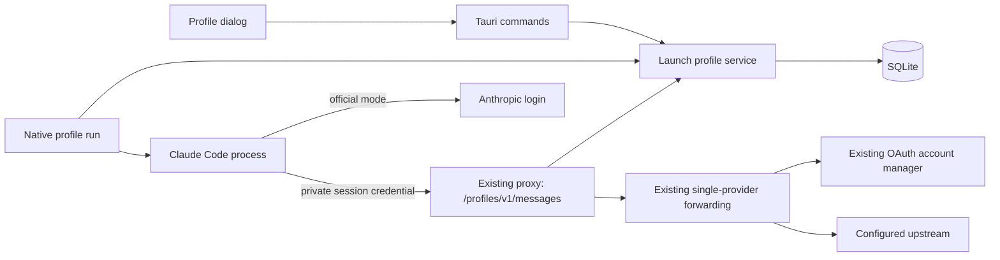
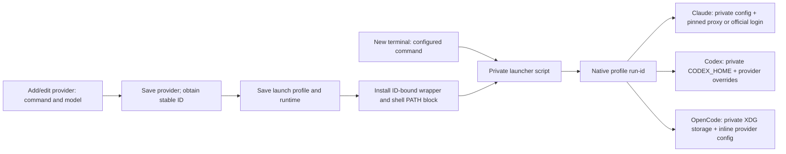

# High-level design

Extend existing persistence, command and proxy layers with launch profiles, distinct from project snapshot profiles. Use additive tables, leaving existing records and SCHEMA_VERSION unchanged. Profile records contain no credentials. A launch issues a random session credential; only its digest and immutable routing fingerprint persist. Each request validates profile revision and provider configuration fingerprint. A change revokes the session with an explicit error. No upstream credentials are copied into launchers or profile directories.



```mermaid
sequenceDiagram
 participant User
 participant Launcher
 participant DB
 participant Claude
 participant Proxy
 participant Upstream
 User->>Launcher: profile run alias + arguments
 Launcher->>DB: validate profile/provider; issue session
 Launcher->>Claude: exec with isolated environment/directory
 Claude->>Proxy: Messages + session credential
 Proxy->>DB: validate revision and provider fingerprint
 alt valid
 Proxy->>Upstream: existing conversion + account auth
 Upstream-->>Claude: response via proxy
 else deleted/changed/invalid
 Proxy-->>Claude: explicit error, no fallback
 end
```

Official profiles use fresh directories with independent Claude login. Routed profiles use one listener and the single-provider StackTarget forwarding mechanism. Editing/deleting a profile revokes existing routed sessions. Direct official sessions keep their launch directory. Initial model selection is optional and is not a permanent model lock. No automatic copying of Skills, MCP or login files. Existing users and global routes retain their original behavior.

## Runtime and installation extension



Old payloads retain Claude behavior. Installation has a separate failure boundary from provider persistence, surfaced explicitly in the UI. Native Codex official login remains separate from Auth Center credential storage. Unsupported native Codex format-converting routes fail clearly. No second proxy listener is introduced.
