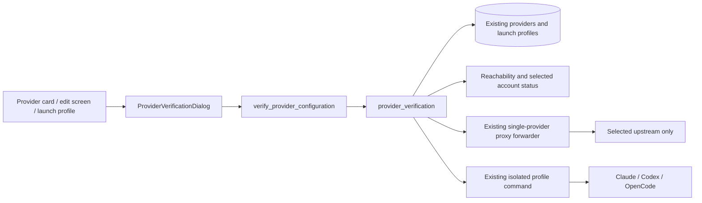

# Provider verification

The **Verify provider** action appears on every provider card, in the provider edit screen and on each saved launch profile. It tests persisted configuration, not unsaved form values. Adding a provider does not automatically call a model.

## Using the UI

1. Save the provider. Open **Verify provider**.
2. Choose the saved provider configuration or an associated Claude/Codex/OpenCode launch profile. The latter checks that profile's private account rather than the default CLI account. Opening from a profile fixes the selection to its immutable ID.
3. **Check connection / login** checks reachability and local credential/login state without generating text. API-key presence, OAuth account presence and CLI-reported login remain explicitly unverified.
4. Optionally enter a model ID. Otherwise use the saved model; native clients may resolve their own default. For OpenCode, overrides must belong to the selected provider.
5. Confirm that the request may use quota, then click **Send test request**. The test requests a short fixed response. Only actual model text counts as successful generation. It neither promises future availability nor proves a model is free.

Endpoint, authentication and model response are displayed separately, with the HTTP status when available and a timestamp. HTTP 200 from a model catalog does not prove login. An HTTP 401/403 still means the endpoint answered, but a generation request rejected with those statuses fails authentication. An unauthenticated reachability request receiving 401 does not invalidate a stored key which it did not send.

For native login, launch the profile and authenticate through its own CLI. Logging into the default OpenCode/Claude/Codex directory does not log into another profile. No credentials, MCP settings or Skills are copied by the diagnostic.

## Architecture

`src-tauri/src/services/provider_verification.rs` resolves saved provider IDs within the selected application's namespace. Profile IDs must match both runtime and provider. It returns a finite `VerificationReport` containing endpoint/authentication/model states, reason code, HTTP status and timestamp; raw model responses, stderr and credentials never reach the UI.

API configuration is adapted from existing tool schemas and sent through `RequestContext` with an explicit `StackTarget`, using the existing Claude multi-format forwarder for Anthropic, Chat Completions, Responses and Gemini. This starts no listener, bypasses global provider selection and disables failover. Request-body overrides are removed from the diagnostic copy to preserve the fixed prompt and lack of tools; stored configuration is unchanged. Native OpenCode uses its actual CLI, which matters when a provider restricts access by client.

Routed profiles first validate the same launch environment and local proxy availability as a launch. The issued diagnostic session capability is revoked immediately. Upstream inference then uses the in-process forwarder with the explicitly selected provider. This tests proxy availability and the upstream separately; it does not constitute an end-to-end HTTP test of the profile route. Existing route integration tests cover that boundary.

Managed Codex OAuth, Copilot and xAI OAuth require an explicit account binding. Inspection reads that exact account's existing manager status, including reauthentication flags; it does not substitute the default account. Actual generation uses existing token refresh/injection. Official Claude/Codex and native OpenCode checks reuse `launch_profiles::command_by_id`; they never inspect the global CLI login.

Native generation runs from an empty temporary directory with null stdin, a 60-second deadline and bounded stdout/stderr. Claude receives an empty tools list, strict empty MCP configuration and nonpersistent print mode. Codex uses ephemeral execution, ignores user configuration/rules and requests a read-only sandbox. OpenCode uses pure mode, disables project configuration and denies tools. The profile remains trusted user configuration: this is not an OS security sandbox and native CLI caches/token refresh may still write inside that profile. No shell command is composed from profile/model input.

No new database tables, secrets, background polling or dependencies are added for diagnostics. The existing profile-session DAO gains explicit revocation for the temporary probe capability. Reports live only in UI memory and are cleared when the selection/model changes.

## Compatibility and limits

- All application/provider screens expose the action. API-key schemas for Claude, Claude Desktop, Codex, Grok Build, Gemini, Agy, OpenCode, OpenClaw, Hermes, Pi, Oh My Pi, Mcode, Dsh and Kimi are covered by schema tests.
- Generic API probes cannot validate every native login protocol. Official Gemini/Agy/Kimi and other native-only configurations report that a native check is required; this is not displayed as successful authentication. Claude/Codex/OpenCode profile diagnostics are supported. Existing native account controls remain available.
- Unresolved environment/file credential references require the native client rather than sending reference strings as credentials. Pi/Omp use their existing usage-key resolver.
- A valid key may intentionally be absent for a public/local model. Successful text generation then reports that no stored key was used; it does not assert that an account was authenticated.
- Native CLI option/output compatibility is version dependent. The installed help for Claude Code 2.1.316, Codex 0.166.0 and OpenCode 1.18.15 was inspected. Older versions may fail the diagnostic explicitly. No live subscription requests were used for automated verification.
- The small API test allows 64 output tokens; some reasoning models need a larger budget and can return no text. Such a result is not reported as verified. Native clients control their own inference budgets.
- Free-model availability, client restrictions, provider policy, billing and future access are not inferred from a stored login or model listing.

## Security and troubleshooting

401: reauthenticate or replace the selected key. 403: check model permissions and client restrictions. 429: check quota/rate limits. A missing bound account or unavailable local proxy fails explicitly. CLI failures use a generic error rather than exposing stderr which could echo a secret. Same-user processes can inspect child environments; profiles are configuration isolation, not OS user isolation.

To remove this addition, revert the verification command/service, UI component/API and associated strings/tests. Existing provider/profile rows and credentials require no migration or rollback. Keep the profile-session revocation helper if another caller needs it.

## Test seams

`tests/components/ProviderVerificationDialog.test.tsx` covers explicit consent, no inference on opening/inspection, immutable profile selection, failed authentication display and stale-evidence clearing. The existing edit-dialog fixture now supplies the same QueryClient context as the application.

Backend tests exercise finite error reports, actual text versus catalogs, streaming errors, all persisted tool API schemas, missing OAuth bindings, literal native arguments/exit codes and a local mock upstream. They verify that inspecting does not generate, the selected key is sent, and a different global provider is neither called nor changed. No real subscription quotas are used. See `multi-profile/testing.md` for final run evidence and manual acceptance.

## Manual checks

- Save a test API provider, open the shield action, and inspect: model remains **Not tested** even when the endpoint responds. Repeat with the global active provider set to another account.
- Use an invalid test key and explicitly send a request: 401 must show failed authentication, never a successful login. A 403/429 must remain a denied/rate-limited result.
- Choose an isolated profile whose CLI is logged out. Inspect it while the default CLI is logged in: the private profile must not borrow the default login. Log in within that profile, inspect again, then explicitly test a model.
- For OpenCode public/free models, successful generation must not alone prove account identity. Verify free-tier/client permissions with the provider separately.
- Stop the local proxy and test a routed profile: it must fail without trying another provider. Restore the proxy and retry.
- Change the selection/model or close/reopen the dialog: prior evidence must clear. Confirm default Claude/Codex/OpenCode credentials, existing Skills and MCP remain unchanged.

Frontend implementation: `src/components/providers/ProviderVerificationDialog.tsx` and `src/lib/api/providerVerification.ts`; entry points extend `ProviderCard.tsx`, `EditProviderDialog.tsx` and `profiles/LaunchProfilesDialog.tsx`. The thin IPC wrapper is `src-tauri/src/commands/provider_verification.rs`, registered in `commands/mod.rs` and `lib.rs`. Existing endpoint extraction (`services/stream_check.rs`), private launch command resolution (`services/launch_profiles.rs`), proxy forwarding state (`proxy/server.rs`) and temporary session revocation (`database/dao/launch_profiles.rs`) are reused rather than adding another proxy.
